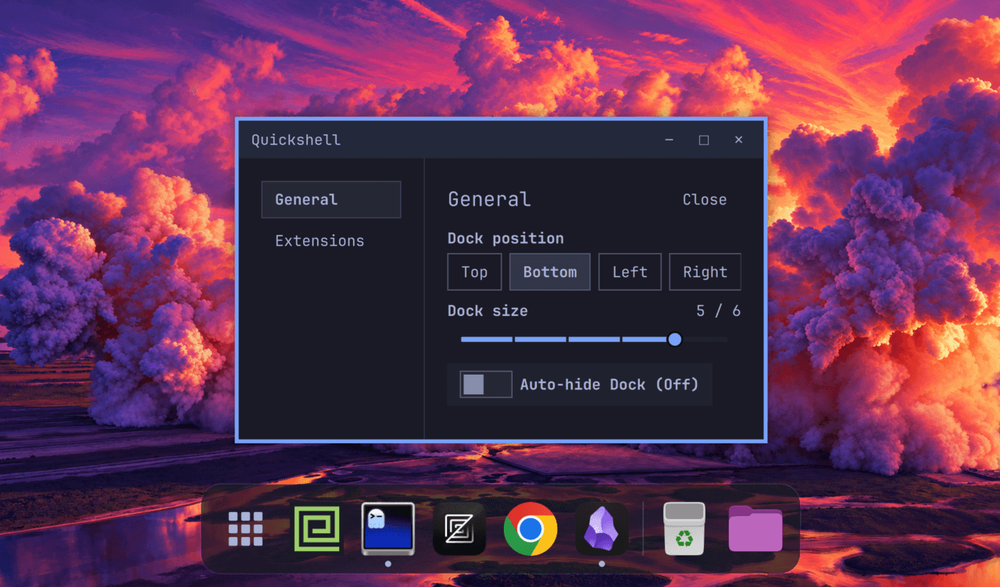

# DogeDock

DogeDock is a fork of the Omarchy dock. It works in every regular workspace layout, opens files dropped onto compatible apps, and has a settings panel for the Dock and its extensions.

https://github.com/user-attachments/assets/d891d122-bd5c-4740-be3f-dea4517804ef

## Requirements

DogeDock uses Omarchy Shell's Quickshell components and Dock preferences. It is based on the Dock shipped with Omarchy 4.5.0 and needs the host's `qs.Commons` and `qs.Ui` QML modules.

Runtime dependencies:

- Omarchy Shell, Quickshell, and Hyprland.
- System Python at `/usr/bin/python`, with PyGObject and Gio/GioUnix for file type and desktop entry matching. Folders and Wallpaper also use Python to list directories.
- `gio` for opening files and directories and managing the system Trash, and `notify-send` for failure notifications.
- Bash, `jq`, `flock`, and standard filesystem utilities for saving settings.

## Install

Run the standard Omarchy plugin command in a terminal and confirm the installation prompt:

```sh
omarchy plugin add https://github.com/harryxu/omarchy-dogedock.git --enable
```

Omarchy installs and enables DogeDock in the running Shell. A shell restart is not required. Enabling DogeDock automatically replaces the built-in `omarchy.dock`.

Check the status with `omarchy plugin list`: `harryxu.dogedock` should be enabled and `omarchy.dock` disabled. If you installed without `--enable`, run `omarchy plugin enable harryxu.dogedock` to enable it later.

## Restore the built-in Dock

```sh
omarchy plugin disable harryxu.dogedock
omarchy restart shell
```

Omarchy restores the built-in Dock if it was enabled before DogeDock took over. If you had already disabled it, run `omarchy plugin enable omarchy.dock` to turn it back on. To uninstall DogeDock, run `omarchy plugin remove harryxu.dogedock`.

Uninstalling removes the plugin files but keeps your private settings in `$XDG_CONFIG_HOME/harryxu.dogedock/settings.json` (by default `~/.config/harryxu.dogedock/settings.json`). Omarchy's Dock preferences in `~/.config/omarchy/shell.json` are also retained.




## Using the Dock

Right-click the app launcher and choose **Settings** to change the Dock's position, icon size, corner style, background transparency, auto-hide behavior, and extensions.

- The Dock works in every regular workspace layout and hides when an application is fullscreen. With auto-hide off, tiled and maximized windows leave space along its screen edge.
- The translucent background follows the current Omarchy theme and sits slightly in from the edge. Its corners are rounded by default. Running apps have a dot below their icon. The launcher uses a compact grid icon.
- App icons are sized and centered by their visible artwork, ignoring transparent padding and faint shadows. They keep their proportions and stay at full opacity, including while launching or when a pinned app is closed.
- Hovering keeps the arrow cursor and icon size unchanged. An app's name appears immediately in a themed tooltip; on a bottom dock, it appears above the icon.
- Clicking a running app brings its window to the front, including from another workspace, without moving the pointer.
- Drag local files or folders from a file manager onto an app. A target highlights when its desktop entry accepts file or URI arguments or declares D-Bus activation. The app decides which items it can open. Drag to the screen edge to reveal an auto-hidden Dock.

The app grid runs as an Omarchy menu and uses Omarchy Shell to discover, search, and launch installed apps.

## Dock extensions

Open **Settings → Extensions** to enable extensions and edit their settings. Trash and Folders start enabled if you haven't saved an extension configuration. Extension icons appear after the apps in configuration order.

- [Trash](extensions/trash/README.md)
- [Folders](extensions/folders/README.md)
- [Wallpaper](extensions/wallpaper/README.md)

### External extensions

Choose **Add external extension…** and select a directory containing the extension's manifest. DogeDock validates it, adds the extension to the list, and loads it. Both external and built-in extensions can provide a settings page or use the standard inline controls. Disabling one keeps its settings. Removing it unloads the extension and clears its DogeDock configuration while leaving the source directory intact.

External extensions run as trusted QML inside Omarchy Shell with your user permissions. Only add code you trust.

The [Hello Extension example](examples/helloext/README.md) demonstrates name icons and a closable greeting. It stays uninstalled until you add it yourself.

## Configuration

DogeDock saves icon size, appearance preferences, and extensions in `$XDG_CONFIG_HOME/harryxu.dogedock/settings.json` (by default `~/.config/harryxu.dogedock/settings.json`). You can also edit the top-level `extensions` array: use an absolute `path` for an external extension or an `id` for a built-in. Set `enabled` to `false` to retain a disabled entry. String entries such as `"trash"` also enable extensions.

Position, auto-hide, and pinned apps use Omarchy's `dock` settings in `~/.config/omarchy/shell.json`. If you're upgrading from an older DogeDock version, set the icon size and enable extensions again in the panel, or enter your values in the new file.

For local development, testing, and extension authoring, see the [development guide](docs/development.md).

## License and origin

DogeDock is distributed under the [MIT license](LICENSE), including the original copyright notice by David Heinemeier Hansson. Its starting code was copied from the Dock in the installed Omarchy package `4.5.0-3`, corresponding to [Omarchy 4.5.0](https://github.com/omacom/omarchy/tree/v4.5.0/shell/plugins/dock).
